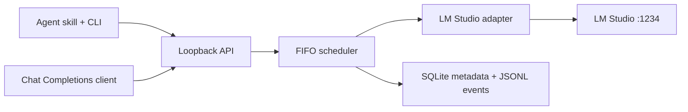

# Local LLM Broker design

Written 2026-10-24 before the first implementation. It records the design reasoning; where behavior has since changed (for example profiles now come only from `config.toml`), [operations](./operations.md) is current.

## 1. Requirements and technical choices

The goal is a system-wide broker for local models so independent LLM/agent sessions can send jobs to one scheduler. Sessions get a reusable skill and access to the broker. Only local inference is in scope. LM Studio is the runtime, running at `http://127.0.0.1:1234`. The author's development machine has 12 GB of VRAM, which is why the design cares about one model at a time and CPU offload.

The following are proposed engineering choices, not confirmed performance claims:

- Python 3.11+ with FastAPI, Uvicorn and HTTPX; standard-library SQLite and TOML support. Use a virtual environment and a `src/` package. Development tools: pytest, pytest-asyncio, Ruff and mypy. Pin tested versions during implementation.
- One background broker process, one Uvicorn worker, one scheduler and one LM Studio lifecycle owner. Reject a second instance using a lifetime-held OS lock in the data directory; bind-port failure alone does not protect separate ports controlling the same GPU.
- Bind to `127.0.0.1:1235`; fail clearly if occupied. Backend remains `127.0.0.1:1234`.
- Expose both a small job API for agents and an OpenAI-compatible Chat Completions subset for apps. Make the CLI the first supported agent interface; MCP is optional later.
- Work payloads and results live in memory. SQLite and JSONL contain operational metadata only. Pending jobs are not replayed after a process crash.

Giving a session folder access lets it read instructions and invoke a client when shell access is available. Folder access alone neither starts the service nor redirects a client's native model traffic. The skill must explain this accurately. Apps that support a configurable Chat Completions base URL can use `http://127.0.0.1:1235/v1`. Agent sessions can otherwise submit subjobs through the CLI. Native Responses or Anthropic Messages clients are not automatically compatible with Chat Completions.

## 2. Lessons from an earlier prototype

The design builds on an earlier single-project prototype (a helper script and a broker module) that is not part of this repository.

The prototype uses a shared SQLite FIFO queue, caps parallel work by model profile, blocks later same-model jobs behind a queued model switch, and removes requests whose client process has died. Its scheduling rules were reimplemented here; nothing depends on it.

Weaknesses to address: successful calls alone receive usage records; errors remain in stderr; model switching/loading and inference share one duration; a silent non-streaming request can look stalled; caller PID liveness does not prove backend inference has stopped; profile limits are sampled before queueing and may be stale by dispatch time.

A large mixture-of-experts model can exceed GPU capacity (the author's 35B model is about 22.1 GB on disk against 12 GB of VRAM), so LM Studio's forced CPU placement of expert layers matters. Treat it as a LM Studio load setting, not an API parameter named `num_experts`, which selects inference experts and is a different setting. The broker passes the tier's `cpu_expert_ratio` explicitly when it loads a model (see [operations](./operations.md)).

## 3. Components and boundaries

The broker owns model lifecycle operations only after it has acquired the GPU resource. Agents never call model load/unload endpoints themselves. One model identity/variant is resident for broker inference at a time; up to its configured slots can run together. Other runtimes, multiple GPUs, distributed machines, cloud providers, fine tuning and model downloads are outside the first release.

Service endpoints, proposed contract:

| Endpoint | Purpose |
| --- | --- |
| `GET /health` | Minimal liveness; do not call LM Studio on every probe. |
| `GET /status` | Readiness, queue counts, active profile, switch state, backend health. |
| `GET /v1/models` | Configured, installed, supported profiles; OpenAI list envelope; no prompt data. |
| `POST /jobs` | Submit non-streaming work; return HTTP 202 and job ID. |
| `GET /jobs/{id}` | Metadata/status/timings; bearer-authenticated. |
| `GET /jobs/{id}/result` | Result after completion; pending 202, expired 410, failed structured error. |
| `DELETE /jobs/{id}` | Request cancellation; do not imply active inference stopped before confirmed. |
| `POST /v1/chat/completions` | Synchronous or SSE response through the same scheduler. |

Use `{error:{code,message,request_id,retryable}}` for broker errors; map compatibility-route errors to the OpenAI error envelope. Explicitly document supported request fields. Preserve message roles, tool calls and supported structured-output options without executing tools. First release accepts text chat, `n=1`, configured models, bounded output and stream/non-stream. Reject unsupported endpoints and input types clearly; image/audio, embeddings, Responses and Messages protocols are deferred. Never silently drop an unsupported field that could change semantics.

`POST /jobs` accepts `client_id`, `project`, `task_label`, `profile`, `messages`, `generation` and optional `queue_timeout_seconds`. Metadata strings are short generic labels, not prompts, filenames or personal details. `generation` is the validated supported inference-parameter subset. CLI builds this body from prompt/system/files. A supplied `Idempotency-Key` is scoped to client ID for 24 hours: identical jobs return the original ID without duplicate execution; conflicting reuse returns 409. Keep a keyed payload digest and key hash in metadata, not prompt contents. Keep the digest key in the protected runtime directory. After restart, return interrupted metadata for a matching old key; never transparently regenerate lost results.

## 4. Models, settings and resource control

Seed profiles from the existing installation, then validate them against LM Studio at implementation time:

| Alias | Model ID | Profile context ceiling | Parallel ceiling |
| --- | --- | ---: | ---: |
| `4b` | `qwen/qwen3-4b-thinking-2507` | 16,000 | 4 |
| `9b` | `qwen/qwen3.5-9b` | 32,000 | 2 |
| `35b` | `qwen/qwen3.6-35b-a3b` | 28,000 | 1 |

(Superseded 2026-11-04: contexts now come from per-model load tiers, and the parallel ceilings are 4 / 3 / 1 for the 4B / 9B / 35B; see [operations](./operations.md) and [live verification](./live-verification.md).) These are existing ceilings, not guaranteed memory-safe defaults. Read current owner-approved LM Studio presets before setting active configuration. CPU offload was adjusted during planning; do not silently replace it with a suggested 8k context or other tuning. There is no default profile for inference: the caller/skill selects one explicitly. Pin the intended quantization variant where the installed API supports it; never fall back to a different model or variant after OOM.

Lifecycle: wait until the current cohort drains; list instances; unload other configured broker-managed models by instance ID; verify unload; explicitly load the requested model using the saved LM Studio preset plus only verified, approved overrides; record backend `load_time_seconds`; inspect the actual loaded context/parallel caps; dispatch within the lower of configured and actual limits. Load once per switch, not per parallel request. Reuse an already loaded, matching instance without reloading. Do not infer available VRAM from file size or a successful load.

Only one model may be loaded at a time. Before any load, every other loaded instance is unloaded once it is idle, including an unconfigured model that the user loaded by hand. Before each batch of jobs, the broker confirms that its last-loaded model is still the only one loaded in LM Studio, and loads it again if not. Direct LM Studio UI/API inference bypasses scheduling; sharing the backend that way during broker switching is unsupported and can invalidate guarantees.

The adapter must verify whether explicit REST loading honors saved CPU-offload and parallel presets on this installed LM Studio version. If it does not, find a supported preset-loading path; never invent load fields to achieve a timing metric. Verified 2026-10-25: it does for the 35B (CPU expert layers and parallel cap from the saved preset, with `model` and `context_length` sent), so the 35B is managed. Separate measured client-side load duration from backend-reported duration and leave unavailable metrics null.

Validate requested context/output before acceptance and again after actual load. Token counts are estimates unless the backend exposes a supported tokenizer; label them as such and retain a safety margin. Proposed guard: estimate prompt tokens conservatively, default output budget 2,048, require explicit opt-in for more, and reject estimated prompt + output + 512 exceeding effective context. Reasoning tokens may consume the output budget. Do not silently trim source files or context. Do not change thinking mode unless the caller explicitly selects a supported option.

## 5. Scheduler, cancellation and recovery

Use a FIFO ticket order. Only one distinct model is active. Fill its slots from consecutive compatible jobs at the queue head. The first different-model job is a barrier: later jobs for the current model must wait. A zero-active interval during a switch is protected by the same lifecycle lock. Never promote jobs to inference before actual load caps are known.

States: `queued -> preparing -> running -> succeeded|failed|cancelled`; `cancelling` represents an active cancellation request; `interrupted` represents restart loss. Preserve distinctions between backend readiness and job state. SQLite stores state transitions transactionally, with UTC timestamps. Payloads remain in RAM. Use a monotonic clock for elapsed durations and deadlines.

Proposed limits: 100 queued jobs, 2 MiB HTTP body, 256 KiB text per job, default queue deadline 3,600 seconds, load deadline 300 seconds, generation deadline 1,800 seconds, 120 seconds maximum stalled stream interval, 1 MiB bounded stream buffer and 2 MiB accumulated non-stream result. Long thinking periods must be considered when interpreting stream silence; a timeout is an error, not proof of backend cancellation. Make limits configurable with finite validated bounds. Reject a full queue with 429 and `Retry-After`. Do not allocate unlimited tasks or buffers before enforcing limits.

Queued cancellation removes only that job. Active cancellation, a disconnected client, an HTTP timeout or a dead caller does not prove that LM Studio has stopped. Keep the GPU slot reserved until the backend confirms termination or the active request drains. If termination cannot be established, set `backend_state=unknown` on that job and fail it with a retryable error. Lifecycle switches are not blocked: they wait for LM Studio to report idle and fail retryably if it stays busy. Do not immediately unload a model used by another active job. Verify actual cancellation behavior on the installed backend; if no reliable cancellation API exists, drain the request or require owner-assisted backend recovery.

The same rule applies to load and unload timeouts: an HTTP timeout may leave the backend operation running, so the job fails retryably. The next job lists LM Studio before any further lifecycle call: it adopts an instance whose load finished, or retries an unload that did not finish. Lifecycle calls are never issued in parallel. `lms ps` does not report a load that is still running inside LM Studio as busy. A retried load can therefore start a second instance (the broker removes the extra one on its next load), and a switch can unload an instance that is still loading.

After a crash, mark unfinished records interrupted. RAM-only results cannot be recovered. Do not replay prompts or auto-retry generation, especially after partially streamed output. Startup does not block on backend state. A model already loaded in LM Studio is adopted when a job needs it, and its context and parallel caps are verified before dispatch. Before the broker unloads a model to switch, it reads `lms ps --json` and waits until that model reports `idle` with nothing queued (up to 120 seconds). If it stays busy, or its status cannot be read, the job fails with a retryable error and nothing is unloaded. Same-model jobs unload nothing and skip this check. The check covers generation and queueing only: `lms ps` reported `idle` while a load was still running (2026-10-26 switch test), so an in-progress load is invisible to it. No operator step remains: an in-run load or unload with an unknown outcome fails its job, and the next job retries it.

There is no operator recovery command, and nothing in the broker waits for a confirmation. Models loaded in LM Studio that are not configured profiles are unloaded automatically before any load, once they are idle.

Results expire from RAM 10 minutes after reaching a terminal state; metadata retains terminal status with `result_expired=true`. Pending 202 and expired 410 are distinguishable. `POST /jobs` survives CLI disconnect until terminal state/deadline; the synchronous compatibility route requests cancellation on disconnect. Streaming holds its slot until upstream is truly done, not until the first token or downstream disconnect.

## 6. Logs, access and configuration

Runtime default: `%LOCALAPPDATA%/LocalLLMBroker/` with `state.sqlite3`, `logs/events.jsonl`, `logs/usage.jsonl`, configuration and protected secret files. Source files remain in this project. Add `--data-dir` for tests/portable use. Configure one backend/GPU owner; a data-directory lock must be complemented by a common backend lock so two differently configured data directories cannot control the same LM Studio endpoint.

Log events for accepted, queued, switch started/finished, load started/finished, inference started/finished, first token, cancellation, timeout, failure and restart. Include request/job ID, client label, profile, lifecycle phase, timestamps, queue/load/inference durations, backend load duration, time to first token, token counts, finish reason and sanitized error code. Capture input/output token counts from usage; missing usage is null rather than zero. Stats summaries distinguish queue time, loading and inference; retain original timestamps and units. Rotate logs at 10 MiB, retain five files per stream; prune terminal metadata after 30 days, preserving unexpired idempotency records. Never delete active jobs during retention.

Never log prompt text, file bodies, result text, bearer tokens, HTTP authorization headers, full backend error bodies or full CLI arguments. Framework access/error logging must also be reviewed. Persist failure events as reliably as success events. On database/log write failure, report degraded readiness and stop accepting new jobs; preserve safe handling of active inference. Document that LM Studio has its own independent logging behavior.

Require a locally generated bearer token on all routes except minimal health. Restrict file ACLs to the current Windows user where feasible; do not put tokens in committed configuration. CLI obtains token from the protected runtime file or environment. Bind loopback, reject unexpected Host/Origin values and do not enable permissive CORS. Backend URL comes only from service configuration and must be loopback; requests cannot supply arbitrary upstream URLs. No public/LAN exposure, cloud proxy or model downloads.

## 7. CLI and reusable skill

Proposed commands: `llm-broker serve`, `doctor`, `models`, `status`, `submit`, `wait`, `result`, `cancel`, `logs`, `summary`. `submit` accepts `--client`, `--project`, `--task`, `--model`, prompt file, `--system-file`, `--files`, `--out`, `--max-output-tokens` and optional `--detach`. It reads files client-side, rejects excessive input before submission, sends text only, polls status without keeping one shell call blocked indefinitely, and atomically writes the final answer. Print job ID immediately, show changes in queue/load/run state, and provide a command to retrieve detached work. No shell evaluation of prompt contents.

Exit codes: 0 success, 2 invalid input, 3 unavailable/authentication failure, 4 queue expiry/full, 5 load/OOM failure, 6 inference failure, 7 cancellation/interruption, 8 expired result. Document HTTP equivalents. Provide a small Python client `BrokerClient` so scripts need not parse CLI output. Keep runtime location in configuration/environment rather than assuming another project's folder.

Create canonical `skills/use-local-models/SKILL.md` with companion `references/client-commands.md` and `references/model-selection.md`. Follow skill-creator guidance when implementing. Install or link into each supported agent's skill directory only as an explicit installation step; simply storing the file here does not register it everywhere. Provide a manual session prompt for agents without skill discovery. MCP registration is optional future convenience.

Skill behavior:

- Proactively identify useful bounded delegation: summaries of supplied text, mechanical conversions, repetitive drafts, candidate code/text review and structured extraction. Keep decisions, source/evidence judgment and final acceptance with the parent agent.
- Start with `doctor`/`status`, select a model explicitly, submit without calling LM Studio directly, retain job ID, continue independent work, and retrieve/review the result before using it.
- Start with 4B for small mechanical work, 9B for more nuanced extraction/drafting, 35B for tasks that justify its loading and execution cost. These are initial heuristics, not quality guarantees. Group independent jobs for the same model where useful, respecting the FIFO queue and prompt/context limits.
- Keep prompt instructions separate from source files. Bound requested output. Use strict schemas when needed, then independently validate numbers, links, code and evidence. Do not send secrets/personal records. Never accept a local model's claims as sources.
- On errors inspect job status and sanitized logs; do not retry a load/OOM repeatedly, raise caps, change CPU offload, kill another user's job or bypass the broker. Report when unavailable and continue appropriate main-agent work.
- Record calls, selected models, token counts, queue/load/inference times and useful output in project checkpoints when that project requires them. A folder-reading action is not itself model usage.

Include examples for a new Codex session, a Claude session with shell tools, and a generic Chat Completions client. State explicitly that delegating jobs does not replace a session's native model or provide tool execution to a model by itself.

## 8. Migration and acceptance

Before the first live acceptance request, make sure no other client is using LM Studio, and give the broker exclusive lifecycle ownership for the test window. Do not run two independent schedulers against LM Studio. For rollback, stop submitting, let the broker drain, and stop it.

Acceptance requires: two independent client processes submit jobs successfully; same-model caps and FIFO model barriers hold; actual loaded caps constrain dispatch; CPU-offload presets survive switching; OOM/load failures are visible and fail their job rather than switching unsafely; queue/generation cancellation and crash recovery are truthful; stream/non-stream results work; logs contain no sentinel prompt, output or credential; another project can use the skill/CLI with no dependency on this one; backend liveness does not falsely imply readiness. Demonstrate that a user can find a failed request and distinguish queue, load and generation time.

## 9. Primary references checked 2026-10-24

- [LM Studio model listing](https://lmstudio.ai/docs/developer/rest/list): installed models, instance identifiers and loaded configuration.
- [Model loading](https://lmstudio.ai/docs/developer/rest/load): explicit loading and reported load duration. Verify saved-preset behavior locally.
- [Model unloading](https://lmstudio.ai/docs/developer/rest/unload): unload by instance ID.
- [Chat Completions](https://lmstudio.ai/docs/developer/openai-compat/chat-completions): initial inference protocol.
- [Per-model defaults](https://lmstudio.ai/docs/app/advanced/per-model): user-managed load presets.
- [Log streaming](https://lmstudio.ai/docs/cli/serve/log-stream): independent backend diagnostics.

Recheck installed-version behavior before coding adapters. These references do not establish support for reliable cancellation, runtime idle detection or a particular CPU-offload API field.
